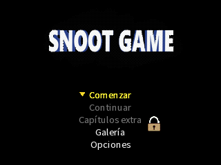
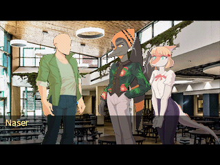
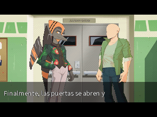
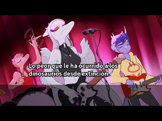
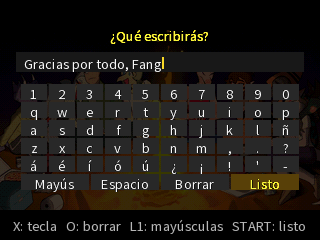

<div align="center">

# Snoot Game para PlayStation

**Port hecho por fans de [Snoot Game](https://git.cavemanon.xyz/Cavemanon/SnootGame) (Cavemanon) a la PlayStation original.**

La novela visual completa, en español, corriendo en una PS1.




</div>

---

## Capturas

<div align="center">


<br>


</div>

<p align="center"><sub>Capturas tomadas en PCSX-Redux con el disco del port.</sub></p>

## Qué incluye

- **El juego completo en español** (traducción oficial): 14,691 líneas de diálogo, la historia, las **4 rutas con sus finales** y los **10 capítulos extra**.
- **Menús pensados para el control:** título, Continuar, Capítulos extra (se desbloquean igual que en el original), Galería y Opciones.
- **3 ranuras de guardado** y progreso (texto leído, finales, galería) en la memory card.
- **Saltar texto ya leído** con R1, que se detiene en lo nuevo y en cada decisión.
- **Música, ambientes y efectos:** 63 pistas de música en XA con bucles y mezclas, y más de 100 efectos y ambientes.
- **Transiciones y animaciones** como en Ren'Py: disolver, fundidos, sacudidas, movimientos, zoom y la caja de texto que aparece y desaparece.
- **Escenas especiales:** el chat del capítulo 4, los créditos finales y un **teclado en pantalla** para el mensaje del capítulo 13D.
- Todo en **un solo CD** (213 MB, el 27% del disco).

## Cómo jugar

1. Descarga el `.zip` de la última versión (sección *Releases*).
2. Abre `snoot_game.cue` (no el `.bin`) en un emulador. Recomendado: **[DuckStation](https://www.duckstation.org/)** con una BIOS de PlayStation.
3. Para guardar hace falta una memory card en la ranura 1 (el emulador la crea sola).

**En consola real:** graba el `.cue` en un CD-R en modo Disc-at-Once y a velocidad baja (4x u 8x). La consola necesita chip o un método para arrancar copias.

> **Aviso:** en PS2 con POPStarter (`.VCD`) por ahora **no funciona**: se queda en la pantalla de inicio. Hay un port nativo para PS2 en camino.

### Controles

| Botón | Acción |
|---|---|
| ✕ | Avanzar el texto / aceptar |
| ◯ | Volver |
| Start | Pausa: seguir, saltar texto leído, guardar, cargar, opciones, salir al título |
| R1 | Saltar el texto ya leído |
| □ | Ocultar la caja de texto |
| Cruceta | Elegir en menús y decisiones |
| Teclado (13D) | Cruceta mover, ✕ tecla, ◯ borrar, L1 mayúsculas, Start listo |

Con **Select** presionado durante la pantalla de inicio se juega sin memory card (no se guarda).

## Cómo funciona

La PC hace el trabajo pesado; la PlayStation solo ejecuta.

```
juego original (Ren'Py)
        |
        |-- scripts .rpy ----> compilador propio ----> bytecode VNB + texto en español
        |-- imágenes .webp --> render + conversión --> 8 bits con paleta, LZ4 (320x180)
        '-- audio .ogg ------> conversión -----------> música XA + efectos ADPCM
                                     |
                                     v
                     motor en C (PSn00bSDK) ----> disco .bin/.cue
```

- **Compilador de scripts** (`tools/script_compiler`): un parser propio de Ren'Py que traduce diálogos, decisiones, variables, animaciones ATL y transiciones a un bytecode compacto ([`docs/bytecode.md`](docs/bytecode.md)).
- **Simulador** (`tools/simulator`): ejecuta el bytecode en la PC y recorre todas las rutas para comprobar que no falta nada.
- **Motor** (`engine/`): máquina virtual, escenas por capas, transiciones, texto con máquina de escribir, música XA por carriles, carga en segundo plano y guardado.
- **Pruebas automáticas** (`tools/engine/emutest.py`, `playtest.py`): corren el disco en PCSX-Redux sin interfaz, juegan solas la historia, las rutas y los extras, y reportan errores, imágenes faltantes y congelones.

Más detalle en [`docs/motor.md`](docs/motor.md), [`docs/compilador.md`](docs/compilador.md) y [`docs/decisiones.md`](docs/decisiones.md).

## Compilar desde el código

> El repositorio **no incluye el juego original**: hay que descargarlo aparte.

### Requisitos (Windows 10/11)

- [Python 3.12](https://www.python.org/) con las dependencias de `requirements.txt`
- [PSn00bSDK](https://github.com/Lameguy64/PSn00bSDK) 0.24 (incluye `mkpsxiso` y `psxavenc`)
- CMake, Ninja, Git y [ffmpeg](https://ffmpeg.org/)
- Opcional para pruebas: [PCSX-Redux](https://github.com/grumpycoders/pcsx-redux) y una BIOS de PlayStation

### Pasos (PowerShell)

```powershell
# 1. Código fuente del juego original en la carpeta original/
git clone https://git.cavemanon.xyz/Cavemanon/SnootGame.git original

# 2. Entorno de Python
py -3.12 -m venv .venv
.\.venv\Scripts\Activate.ps1
pip install -r requirements.txt
python tools/check_env.py

# 3. Todo: scripts, imágenes, audio, motor y disco
python build.py

# 4. Opcional: tests y zip para repartir
pytest
python -m tools.release 1.0
```

El disco queda en `build/engine/snoot_game.cue`. Detalles del entorno en [`docs/entorno.md`](docs/entorno.md).

## Estructura

| Carpeta | Contenido |
|---|---|
| `tools/script_compiler` | Ren'Py → bytecode VNB |
| `tools/simulator` | Ejecuta y recorre el bytecode en la PC |
| `tools/images`, `tools/audio` | Conversión de imágenes y audio |
| `tools/engine` | Fuente, armado del disco y pruebas en emulador |
| `tools/audit` | Auditoría del juego original y comparación visual contra Ren'Py |
| `engine/` | Motor en C para PlayStation |
| `tests/` | Tests con pytest |
| `docs/` | Especificaciones, decisiones y bitácora del proyecto |

## Créditos

- **Snoot Game:** Cavemanon. El arte, la música, la historia y la traducción son suyos.
- **Port de PS1:** Pako Tako.
- Herramientas: [PSn00bSDK](https://github.com/Lameguy64/PSn00bSDK), [mkpsxiso](https://github.com/Lameguy64/mkpsxiso), [PCSX-Redux](https://github.com/grumpycoders/pcsx-redux), [DuckStation](https://www.duckstation.org/) y la documentación de [psx-spx](https://psx-spx.consoledev.net/).

## Licencia

Snoot Game se distribuye con código bajo **AGPLv3** y arte y audio bajo **CC-BY-SA 4.0** (ver el [repositorio original](https://git.cavemanon.xyz/Cavemanon/SnootGame)). Los discos generados contienen ese material y se rigen por esas licencias.

Proyecto de fans, sin relación oficial con Cavemanon ni con Sony.
